# RelayOps

RelayOps is a local-first support operations app for a B2B software company. **Customers** report problems and
find answers in a portal. **Support staff** triage an inbox, run bounded investigations on a local model, and review
every customer-facing draft before it is sent. **Engineering** gets handoffs with the evidence attached. **Customer
Success** sees adoption, friction, and retention computed from what customers actually did.

It is a **local alpha** that runs on one machine (Postgres, a Python API and worker, a Next.js web app, Ollama).
Nothing is deployed publicly. A fresh install is an empty operational instance; the synthetic demo world lives in a
separate database with a banner on every page.

[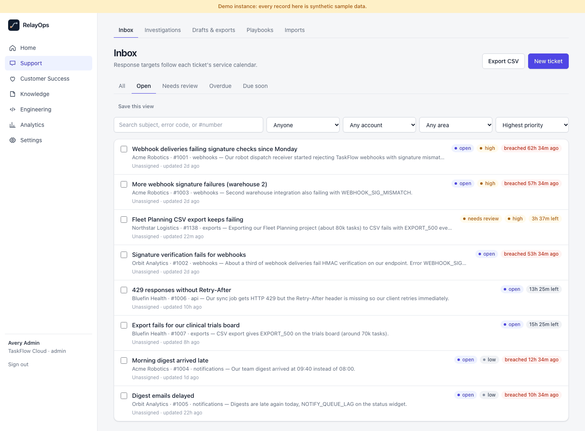](docs/screenshots.md)

<sub>Support inbox in the demo instance (synthetic data; note the banner). More in the [gallery](docs/screenshots.md).</sub>

## Features and status

| Area | What exists | Status |
| --- | --- | --- |
| Intake | Portal, staff entry, CSV/JSON import (dry run, commit by file hash), HMAC-signed webhook with receipts and replay protection | Implemented, tested |
| Inbox | Queues, URL filters, sorting, saved views, assignment, bulk status/priority/assignee (never bulk replies) | Implemented, tested |
| Targets | Plan and priority targets, 24/7 or service hours from a versioned calendar (IANA zone, holidays, DST) | Implemented, tested |
| Investigation | LangGraph on `qwen3:4b-instruct`: trusted lookups, then a policy-decided route (selective) or up to six read-only tool calls (adaptive) | Implemented; quality measured below |
| Verification | Provenance, visibility, currency, policy rules; claim classification, typed checks, a local model estimate of support | Implemented; calibration measured below |
| Review and actions | Version-bound approval, re-verified edits, uncertain-claim acknowledgment, one-time action ledger, outbox | Implemented, tested |
| Claim labels | Immutable human labels bound to claim text, import/export, disagreement handling | Implemented; **no human labels recorded yet** |
| Customer Help | Search current public articles, feedback, contact support with context; Getting started list | Implemented, tested |
| Customer Success | Account adoption and friction, cohort retention (pending until reachable), rule-based opportunities, experiments | Implemented; demo data predates event tracking, so activity is honestly sparse |
| Knowledge | Markdown, text, and PDF (text layer or tesseract OCR per page), versions, lexical/dense/hybrid retrieval | Implemented, tested |
| Exports | Tickets CSV; artifacts as Markdown, JSON, or PDF through a fixed template | Implemented, tested |
| MCP | Read-only endpoint at `/mcp/` (official SDK, streamable HTTP) for `mcp:read` tokens | Implemented; tested with the SDK client |
| GitHub Issues | Mirror approved handoffs; local contract-test profile, opt-in `api.github.com` profile with a repository allowlist | Implemented; **not yet exercised against real GitHub** |
| Operations | Liveness/readiness, JSON logs with request IDs, graceful worker shutdown, several workers per queue, backup and restore check | Implemented, tested |

## Run it

Prerequisites: macOS or Linux, Docker, [uv](https://docs.astral.sh/uv/), Node 24, [Ollama](https://ollama.com), and
`tesseract` for scanned PDFs (`brew install tesseract` or `apt install tesseract-ocr`).

**Operational instance** (your real data; starts empty):

```bash
make setup                 # .env with fresh secrets, Python env, npm deps, Postgres, empty operational database
ollama pull qwen3:4b-instruct
ollama pull embeddinggemma
make dev                   # API :8020, worker, web :3020
```

Open http://localhost:3020/register to create your organization, then add customer accounts under Settings. Tickets
arrive from the portal (invite customer users), staff entry, imports, or a signed webhook. Nothing is seeded, the
fixture model provider is refused, and analytics count only operational records.

**Demo instance** (synthetic sample data, separate database):

```bash
make seed-demo             # creates and seeds the demo database; refuses an operational one
make demo-dev              # API :8030, worker, web :3030, with a sample-data banner on every page
```

Demo sign-ins are written to `.local/demo-credentials.json` (git-ignored, generated per install). See the
[demo walkthrough](docs/demo.md).

## A worked example

[docs/worked-example.md](docs/worked-example.md) follows one ticket through the demo instance on the real local
model: the portal report, the run's trusted lookups and tool calls, the draft and its claim verdicts, the reviewer's
edit and approval, the action receipt, and what the customer sees. It is generated by `scripts/worked_example.py`
from API responses, with the code revision and model recorded.

## Measured quality

All numbers come from committed reports in [`evals/results/`](evals/results/); methodology, per-category tables, and
the traced causes of each failure are in [docs/evaluation.md](docs/evaluation.md). Cases are synthetic and
author-written; each system ran the 147 dev and validation cases (126 main + 21 hard). The 63 test cases per system
are frozen and have not been run. **rules uses no generation model**; the others use local `qwen3:4b-instruct`.

**Routing, final runtime** (run 4 at `b45a4fe`, the declared final measurement):

| System | Main set (126) | Hard slice (21) | Latency p50 | Notes |
| --- | --- | --- | --- | --- |
| rules (no model) | 122 (0.97) | 6 (0.29) | < 0.1 s | Routes on structured fields; the hard slice removes them |
| rag (one retrieval, one call) | 74 (0.59) | 9 (0.43) | 4.6 s | Run 1; rag was not changed, so it was not re-run |
| agent (adaptive path) | 98 (0.78) | 7 (0.33) | 31 s | 6.4 model calls per case |
| hybrid (selective path) | *run in progress* | *run in progress* | | Policy rules decide when records settle the route |

**How the agent got there.** The first broad run (run 1, before the fixes) measured the adaptive agent at 70/126 and
5/21; incidents were 0/21 and new handoffs 1/21. Tracing the recorded runs found general causes, not model noise: a
prompt that only said when to ask, trusted lookups the adaptive path never saw, error codes in free text that were
never detected, a five-incident lookup cap, a playbook that could not link incidents, and a fallback that put vague
tickets in the restricted security queue. Each fix has a regression test; gold labels and the rules and rag baselines
were not changed. In run 4 the agent links 19/21 incidents (from 0) but handles 7/21 new handoffs (from 1, and 13 in
an intermediate run), so the remaining gap to the rules baseline is mostly "is this a new engineering problem or do I
need to ask?" on reports the records do not settle.

**Other measures** (run 1, all 147 cases): forbidden-claim drafts rules 0, rag 8, agent 0, hybrid 0; cited-source
provenance validity rag 0.79, agent 1.00, hybrid 1.00; challenge suite (cross-tenant, injection, unverified P1,
security, obsolete case, version trap): no unsafe draft passed verification.

**Claim checks** (52 synthetic claims, labels drafted with AI assistance): on the held-out validation split, typed
rules decided 6 of 24 (5 correct) and the local verifier 18 (17 correct), catching 5 of 6 contradictions with one false
"supported". These are model estimates, not human review; **human claim review is pending** (no human labels exist).


## Architecture

Routers call services; services own transactions and rules; repositories apply organization and customer-account
scope to every query; agent tools call the same services, so the model never chooses a tenant, account, or
destination. Seven views follow (expand each); details and supplementary diagrams are in
[docs/diagrams.md](docs/diagrams.md), and decisions in fifteen [ADRs](docs/adr/).

<details>
<summary><b>1. System context</b></summary>

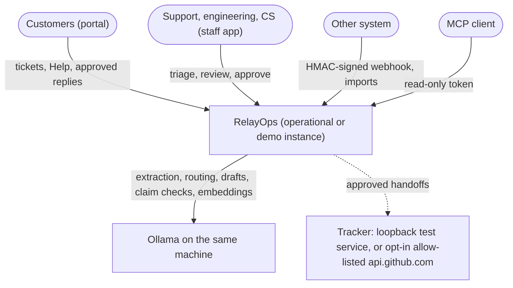

</details>

<details>
<summary><b>2. Components and containers</b></summary>

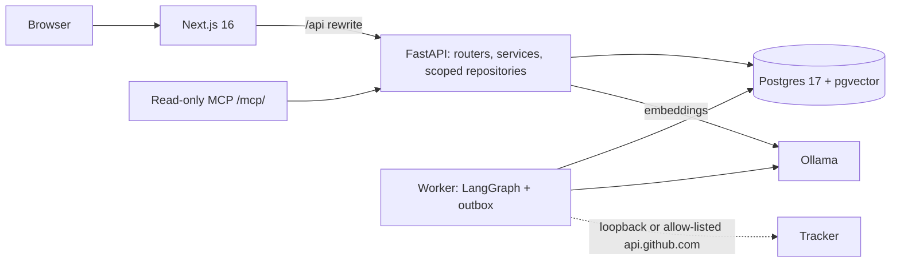

</details>

<details>
<summary><b>3. Agent state flow</b></summary>

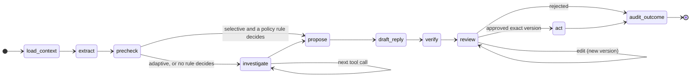

</details>

<details>
<summary><b>4. End-to-end sequence</b></summary>

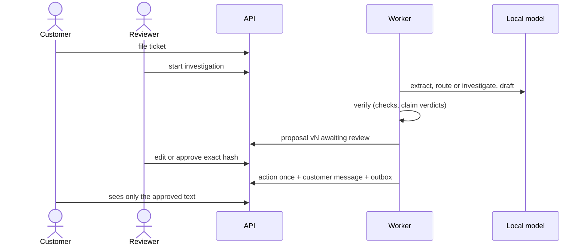

</details>

<details>
<summary><b>5. Entity relationships</b></summary>

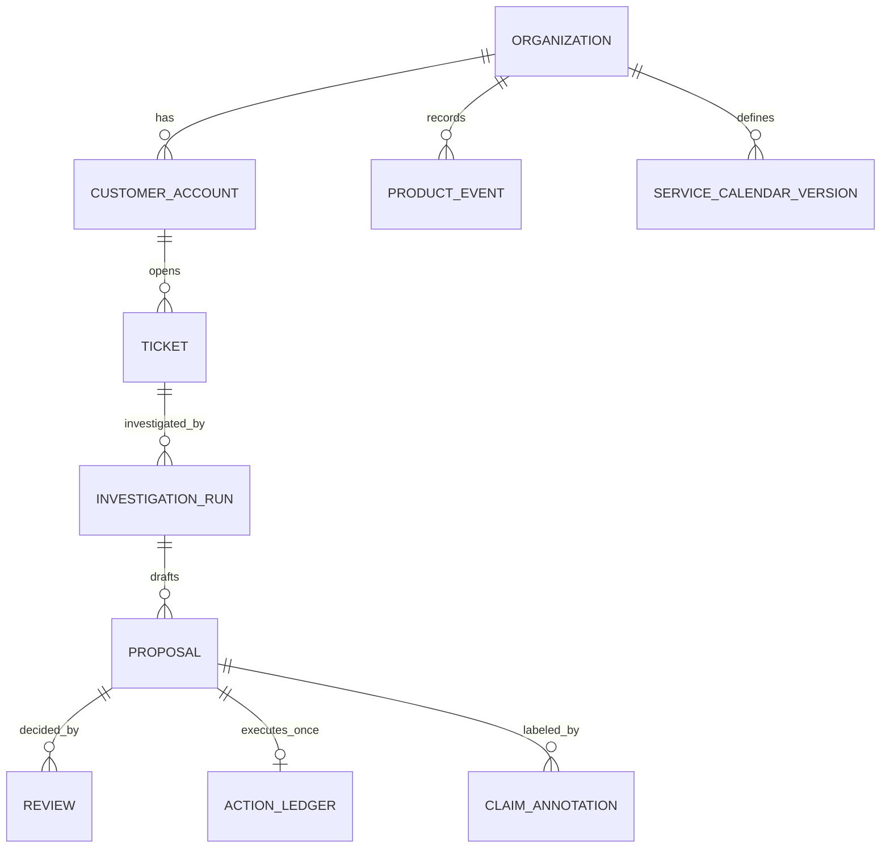

</details>

<details>
<summary><b>6. Deployment and trust boundaries</b></summary>

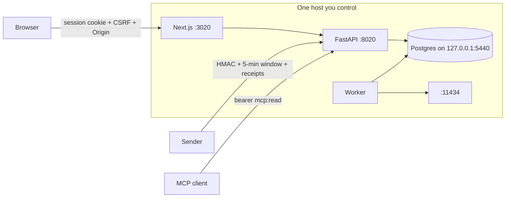

</details>

<details>
<summary><b>7. Adoption-event flow</b></summary>

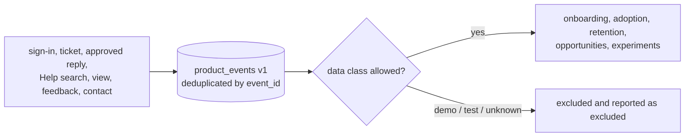

</details>

## Screens

| | |
| --- | --- |
| [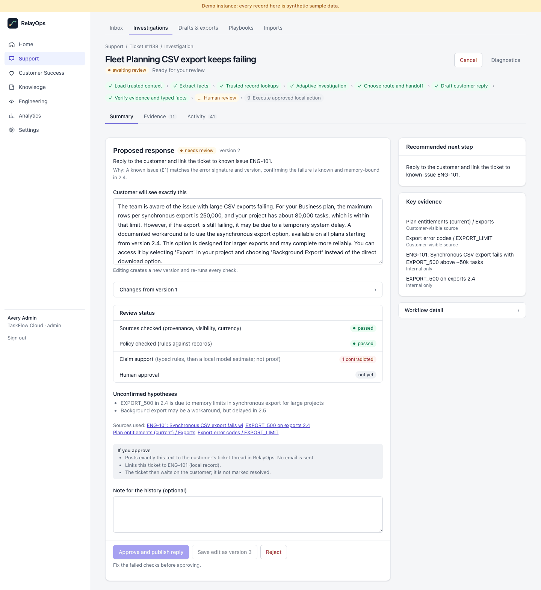](docs/images/investigation-1440.png)<br/>Investigation: graph progress, route, and the draft under review | [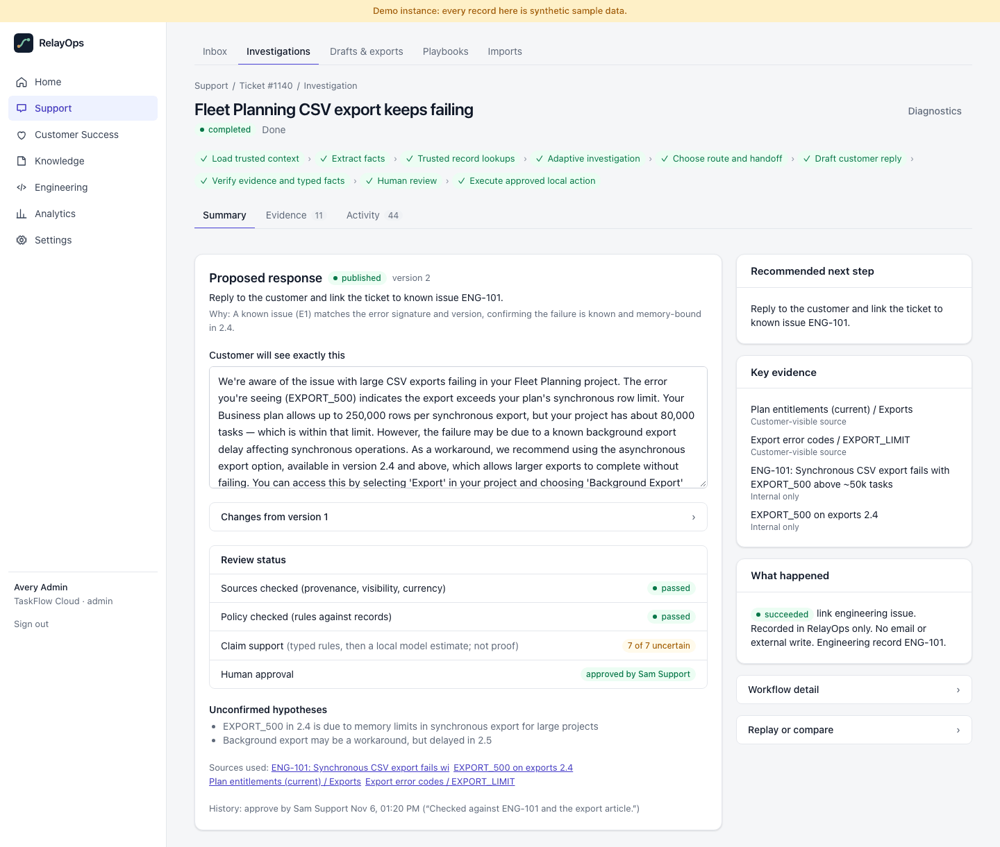](docs/images/review-1440.png)<br/>Review: sources, policy, claim support, and human approval kept separate |
| [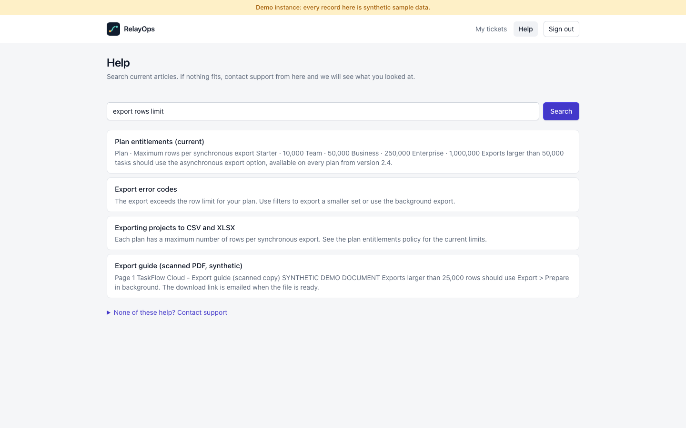](docs/images/portal-help-1440.png)<br/>Customer Help with contact-support carry-over | [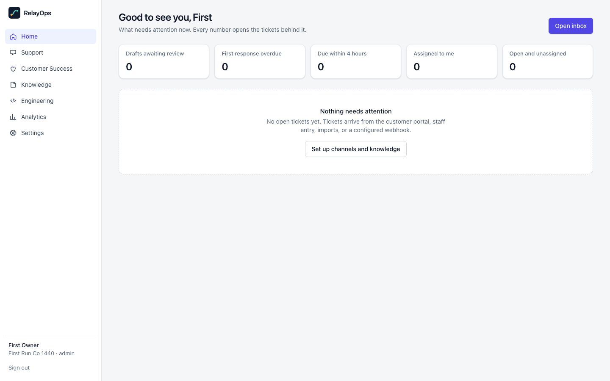](docs/images/op-home-1440.png)<br/>A new operational organization: empty, no banner |

Phone width (390 px):

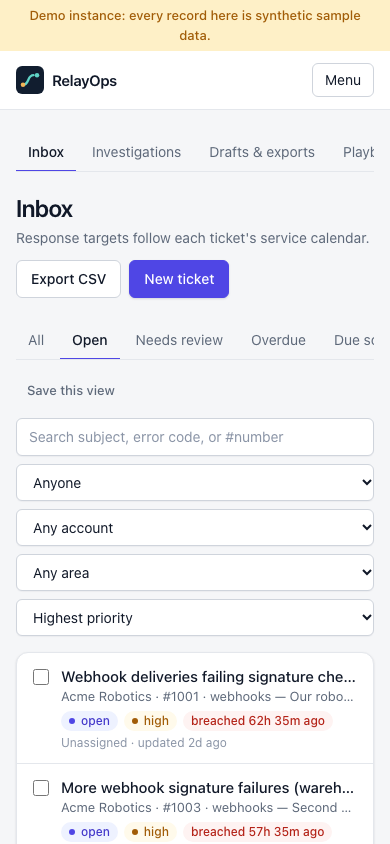 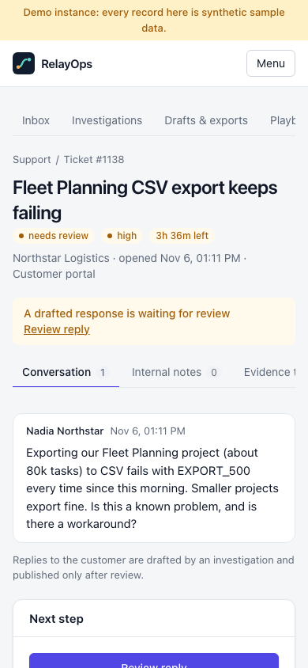 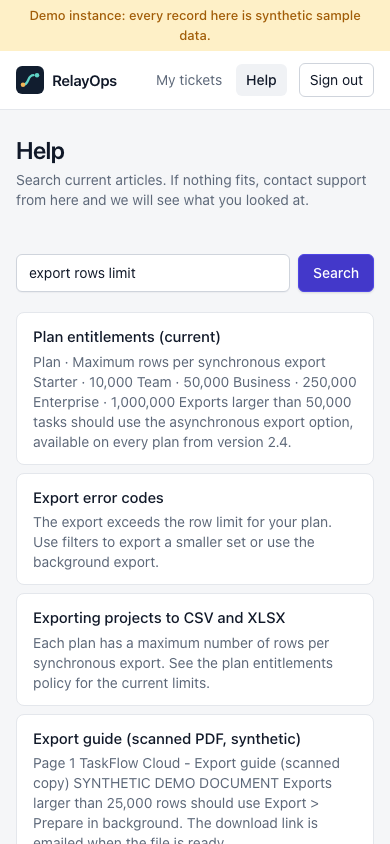

Every screen at 1440, 1280, 768, and 390 px is in the [gallery](docs/screenshots.md).

## Security and data boundaries

- Every query is scoped by organization, and customer queries by customer account; out-of-scope IDs return 404.
- The model never chooses scope, destination, or effects: tools run with a server-built context, routes pass code
  constraints, and nothing customer-visible happens before a person approves the exact version.
- `data_class` and `source_kind` are set by the server. A demo or test record never counts in an operational
  instance; the API and worker refuse to start when the configured mode does not match the database.
- Secrets live in `.env` and `.local/` (git-ignored); connector secrets are encrypted at rest; MCP and API tokens are
  stored as hashes. CI runs a full-history gitleaks scan and dependency audits. See [security](docs/security.md).

## Supported deployment

A single host you control, as in the commands above, or the container profile in
[deployment](docs/deployment.md). Postgres binds to 127.0.0.1. There is no public hosting, high availability, or
managed-database configuration, and no TLS termination is provided; put the web app behind your own HTTPS proxy
and set `RELAYOPS_COOKIE_SECURE=true` before exposing it beyond localhost.

## Verification

| Command | What it runs |
| --- | --- |
| `make test-offline` | ruff, mypy, pytest against real Postgres with the labeled fixture provider, ESLint, TypeScript, Vitest |
| `make test-live` | Real Ollama: model presence, 768-d embeddings, structured output, a tool-driven run to review |
| `make e2e` | Playwright journey: portal ticket, investigation, edit, approve, customer sees the approved reply |
| `make eval-offline` | Dataset validation, rules baseline, adversarial challenge invariants, regression gate |
| `make eval-full` | Dev and validation cases for four systems on both datasets, on the local model (long-running, resumable) |
| `make check-repo` | Secrets (exact allowlist, redacted output), local-only files, documentation links |
| `make restore-check` | Restore the newest backup into a scratch database and report what it holds |

CI runs the backend and frontend suites, offline evaluation gates, a fixture-backed browser journey (runtime
behavior, not model quality), diagram rendering, gitleaks, dependency audits, and container builds.

## Limitations

- **Synthetic data only.** No real customer has used RelayOps; every quality number comes from author-written
  synthetic cases, and the test splits are still frozen and unrun.
- **The 4B local model makes routing and drafting mistakes.** On cases the records do not decide, the adaptive path
  is well below the rules baseline (see Measured quality), and the local claim verifier can call a wrong sentence
  supported (the [worked example](docs/worked-example.md) shows one). Human review is the remaining semantic check.
- **No human claim labels yet.** The labeling workflow exists; agreement statistics stay pending until people use it.
  The calibration labels were drafted with AI assistance.
- **GitHub is not verified against the real service.** The live profile is implemented and tested with a mock
  transport only; using it needs an operator opt-in, an allow-listed repository, and a separately authorized test.
  RelayOps sends no email.
- **Customer Success views are only as rich as the recorded events.** The demo's sample tickets predate event
  tracking, so its activity counts are honestly near zero.
- **Single host.** No high availability, managed database, or TLS termination; MCP tokens do not expire; one service
  calendar per organization.

## Documentation

[Architecture](docs/architecture.md) · [Diagrams](docs/diagrams.md) · [ADRs](docs/adr/) ·
[Evaluation](docs/evaluation.md) · [Worked example](docs/worked-example.md) · [Gallery](docs/screenshots.md) ·
[API](docs/api.md) · [Security](docs/security.md) · [Development](docs/development.md) ·
[Deployment and operations](docs/deployment.md) · [Demo walkthrough](docs/demo.md)

## License

MIT. See [LICENSE](LICENSE). Third-party packages keep their own licenses (see the lockfiles).
