# Diagrams

Seven views of the system, each drawn from the code it describes, plus four supplementary views. CI renders every
Mermaid block in the README and docs with a pinned CLI (`@mermaid-js/mermaid-cli` 11.4.2) and fails on any error
(`scripts/render_diagrams.py`). Nothing here depicts infrastructure that is not implemented: there is no cloud
deployment, load balancer, or managed database.

## 1. System context

Who uses RelayOps and what it talks to. The model runs on the same machine; the tracker connector is limited to a
loopback test service unless an operator enables allow-listed `api.github.com` repositories (implemented, not yet
exercised against real GitHub).

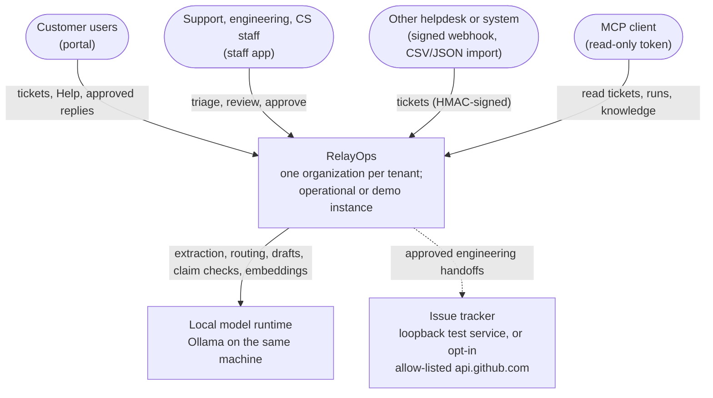

## 2. Components and containers

What runs where inside one installation.

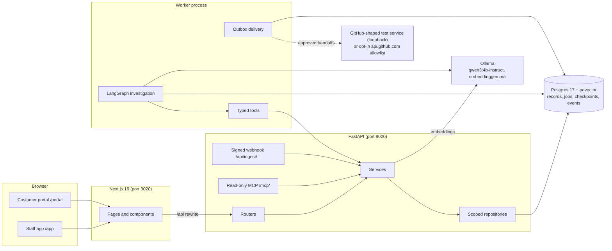

## 3. Agent state flow

The LangGraph nodes for one investigation (`agents/graph.py`). The selective path takes the route from a typed
policy rule when the records decide it; otherwise both paths investigate adaptively.

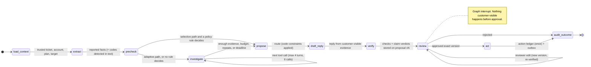

## 4. End-to-end sequence: from ticket to customer reply

Nothing reaches the customer until a person approves the exact version that was checked.

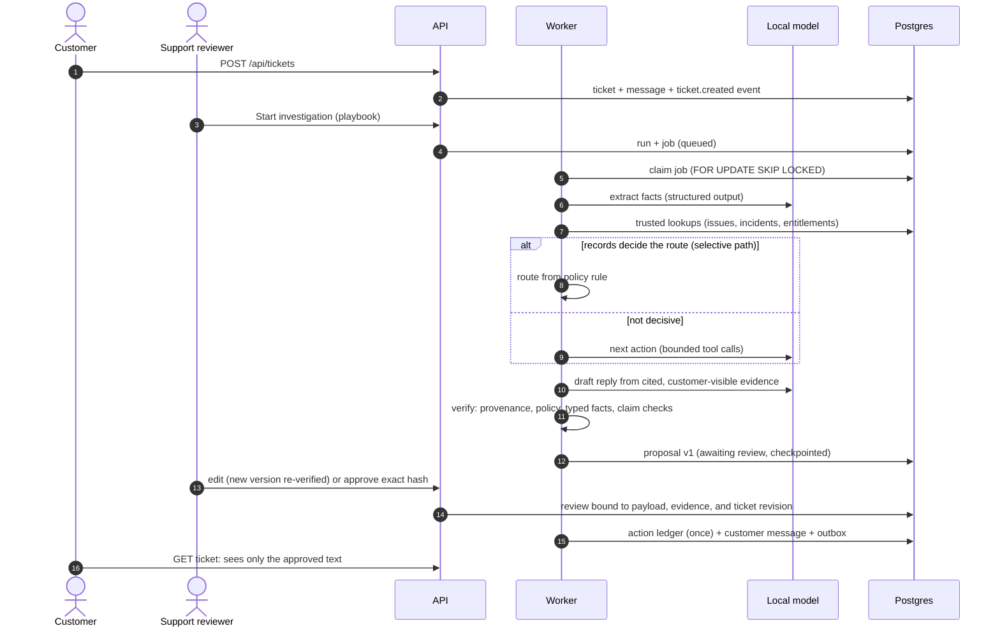

## 5. Entity relationships

A subset of the schema (Alembic migrations 0001–0007). Every row carries its organization, and most carry a
`data_class` (operational, demo, test, unknown) set by the server.

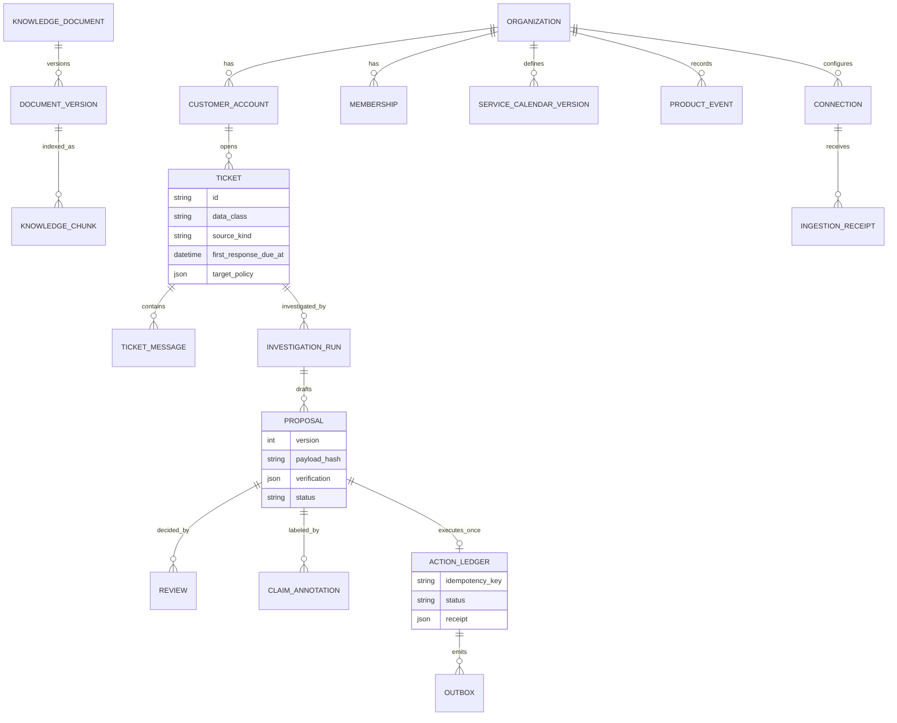

## 6. Deployment and trust boundaries

The supported deployment is a single host. Ports are the defaults; Postgres binds to 127.0.0.1. Each arrow names
the control at that boundary.

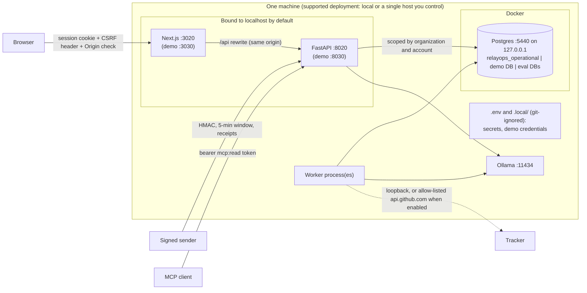

## 7. Adoption-event flow

How customer activity becomes Customer Success views (`domain/events.py`, `services/success.py`). Demo and test
records never reach an operational instance's numbers.

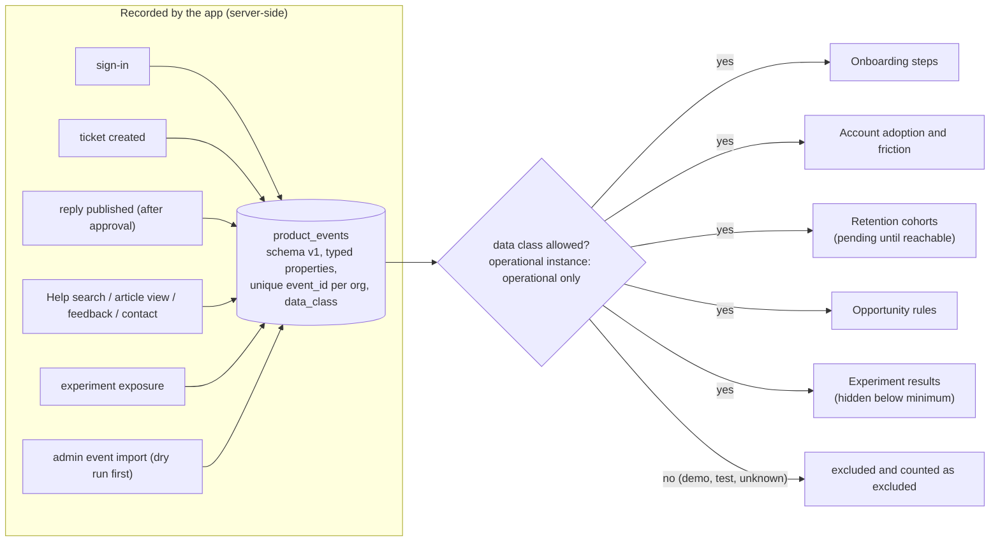

## Supplementary views

### Investigation run lifecycle (state)

Statuses from `services/runs.py` (`ACTIVE`, `TERMINAL`).

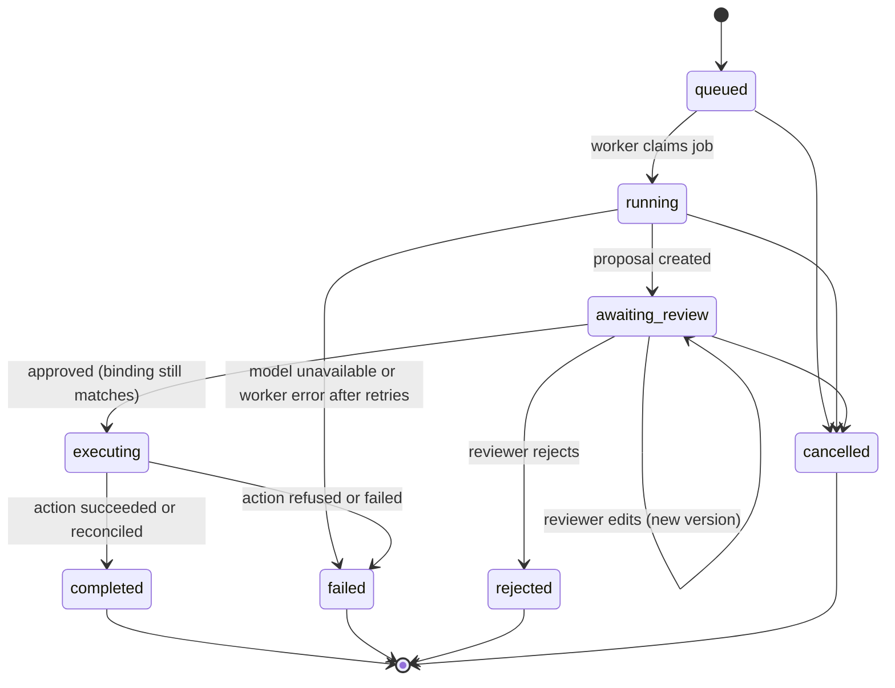

### Claim verification types (class)

`agents/claims.py` and `agents/verification.py`. Method and verdict stay separate so a typed rule, a model
judgment, and a human label are never presented as the same thing.

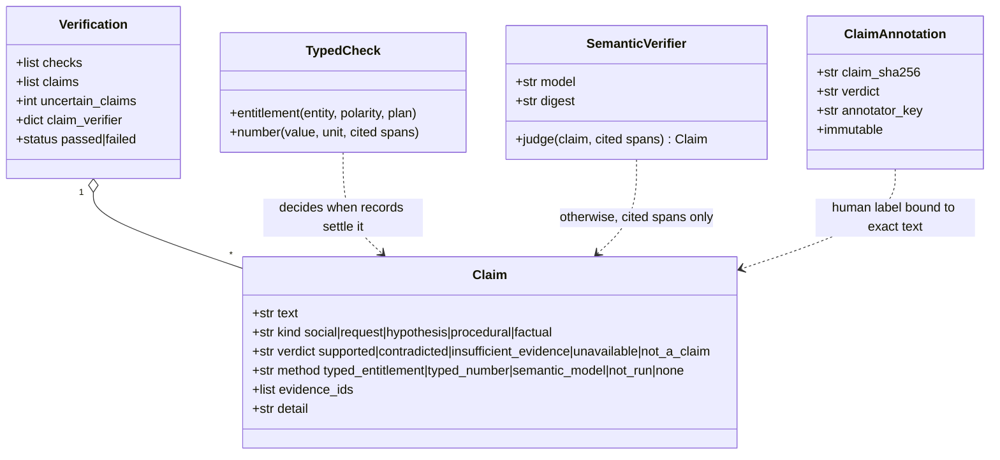

### Customer self-service (user journey)

Scores are the author's expectation of effort, not measurements.

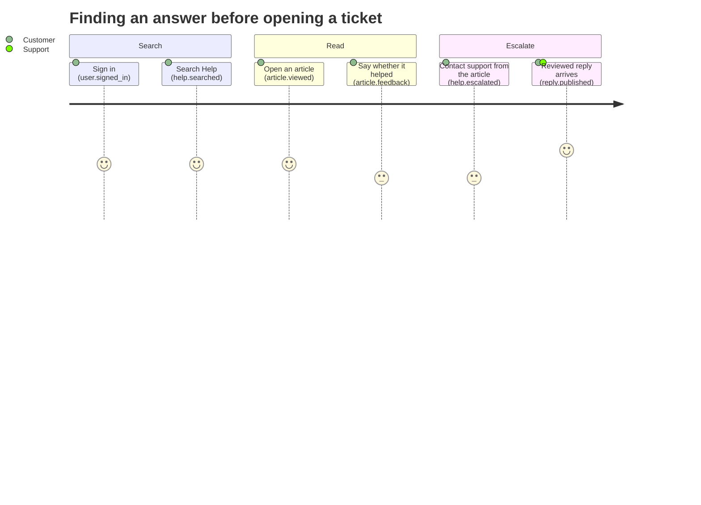

### Evaluation dataset by split (pie)

Case counts from the committed split manifests: `evals/datasets/split_manifest.json` (main set: dev 72,
validation 54, test 54, challenge 6) plus `hard_split_manifest.json` (hard slice: dev 12, validation 9, test 9).
The test splits are frozen and have not been run.

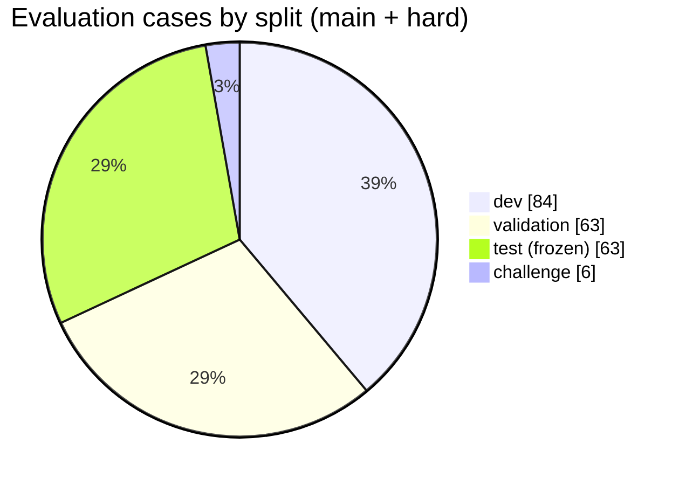
