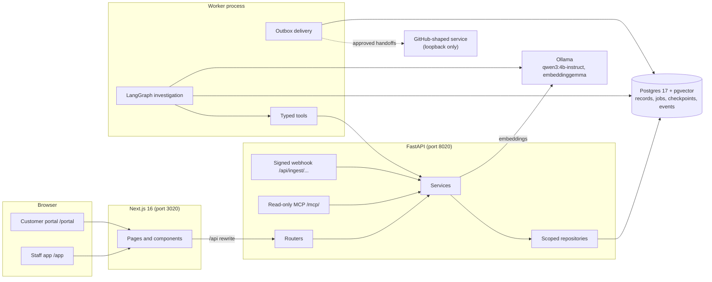
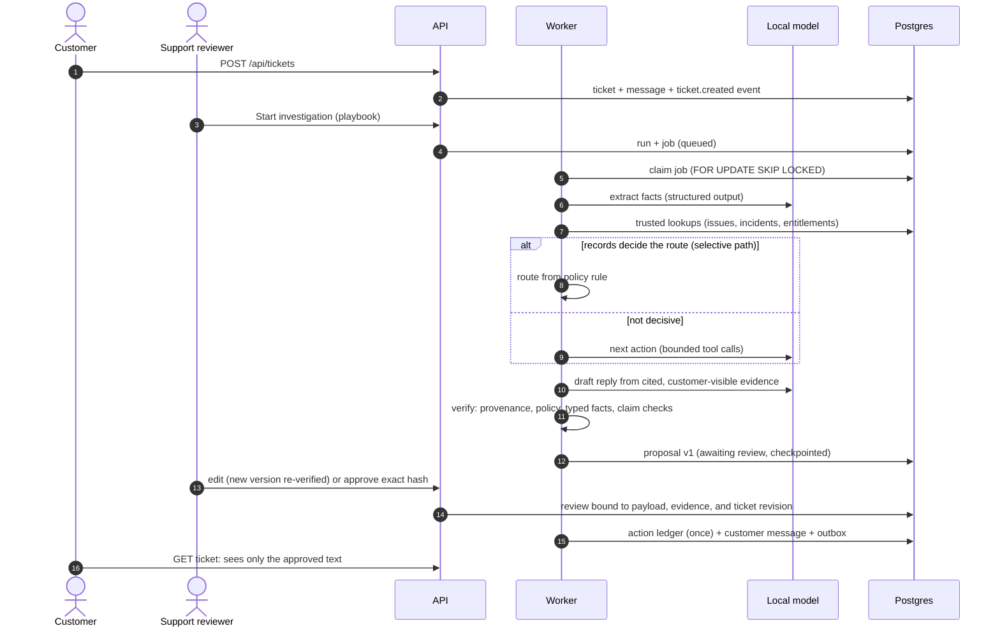
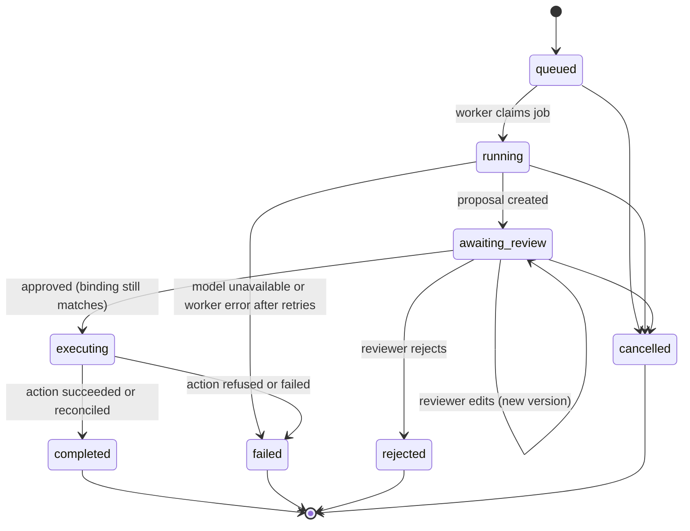
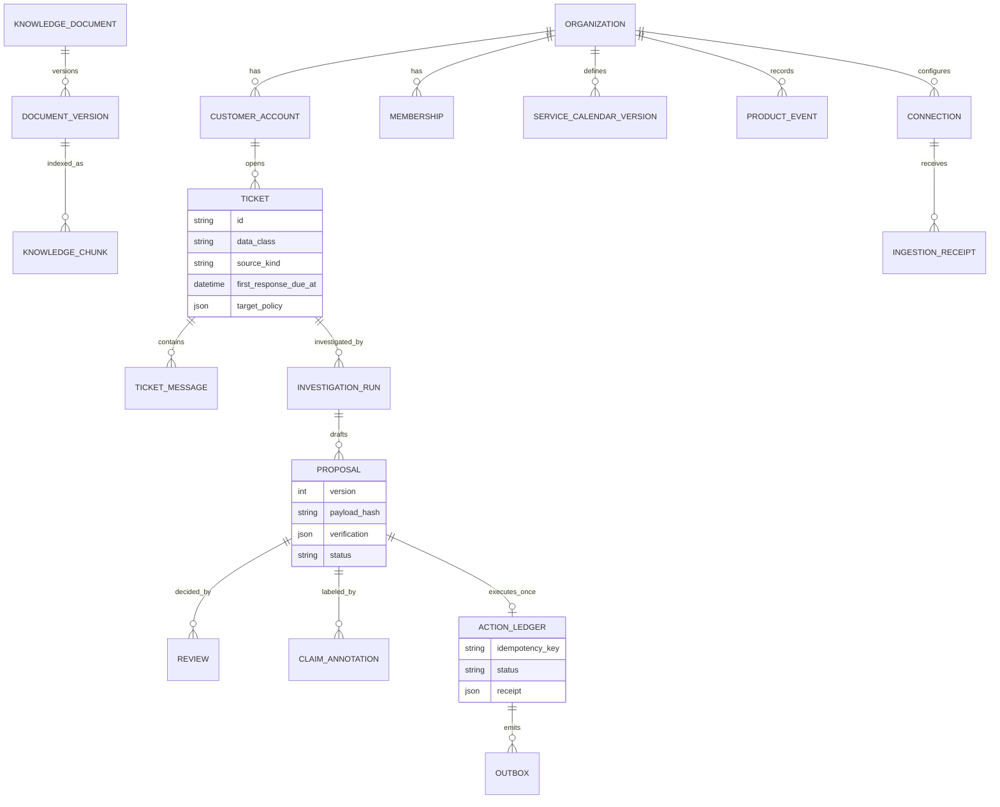
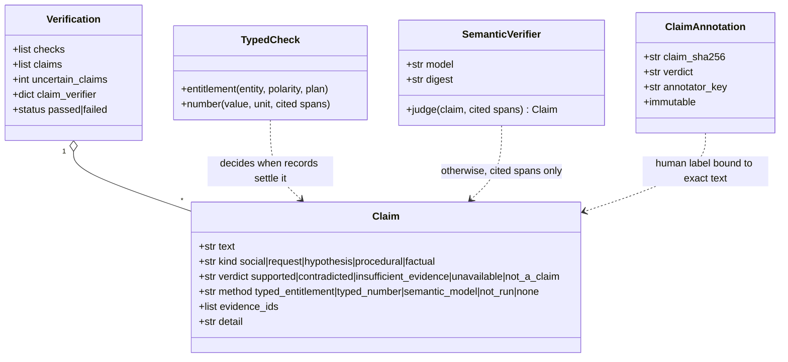
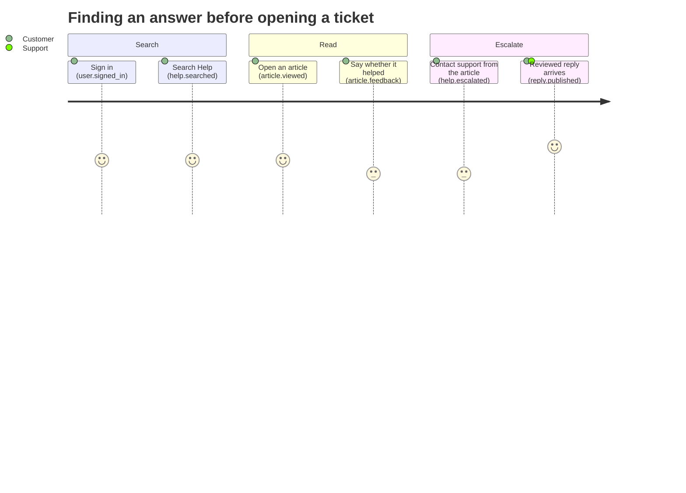
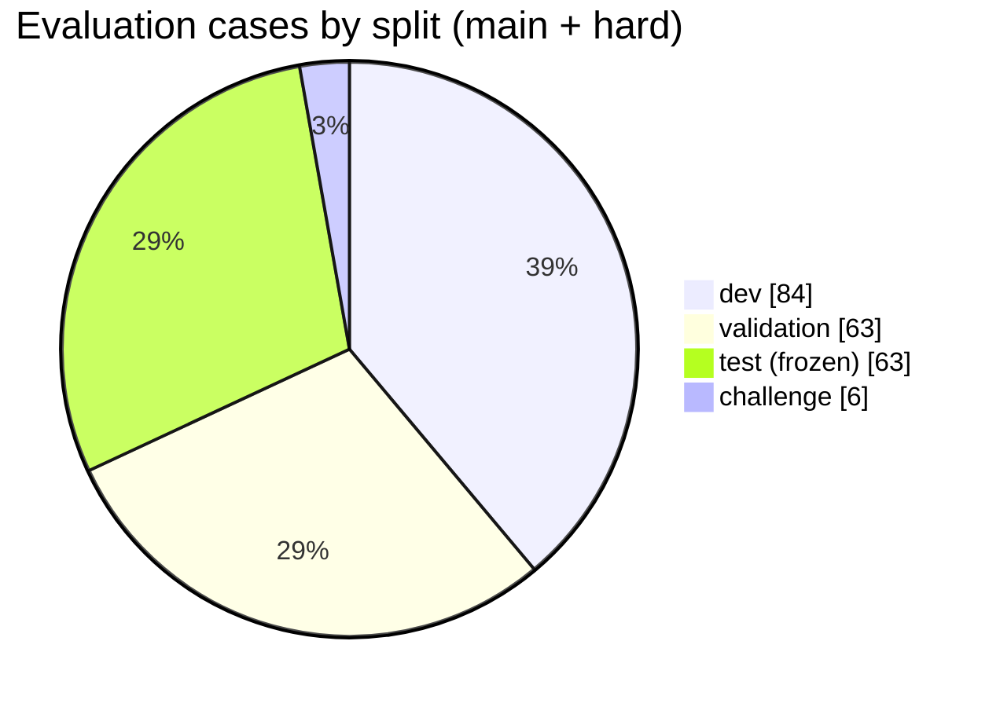

# Diagrams

Seven views of the system, each drawn from the code it describes. CI renders every block on this page with a pinned
Mermaid CLI and fails on a syntax error (`scripts/render_diagrams.py`).

## 1. Components (flowchart)

What runs where. Everything is local: the model runs in Ollama on the same machine, and the only outbound
connector talks to loopback test services in this release.

## 2. From ticket to customer reply (sequence)

Nothing reaches the customer until a person approves the exact version that was checked.

## 3. Investigation run lifecycle (state)

Statuses from `services/runs.py` (`ACTIVE`, `TERMINAL`).

## 4. Core records (entity relationship)

A subset of the schema (Alembic migrations 0001–0007). Every row carries its organization, and most carry a
`data_class` (operational, demo, test, unknown) set by the server.

## 5. Claim verification pipeline (class)

`agents/claims.py` and `agents/verification.py`. Method and verdict stay separate so a typed rule, a model
judgment, and a human label are never presented as the same thing.

## 6. Customer self-service (user journey)

What a customer does in the portal, and which product event each step records (`domain/events.py`).
Scores are the author's expectation of effort, not measurements.

## 7. Evaluation dataset by split (pie)

Case counts from the committed split manifests: `evals/datasets/split_manifest.json` (main set: dev 72,
validation 54, test 54, challenge 6) plus `hard_split_manifest.json` (hard slice: dev 12, validation 9, test 9).
The test splits are frozen and have not been run.

